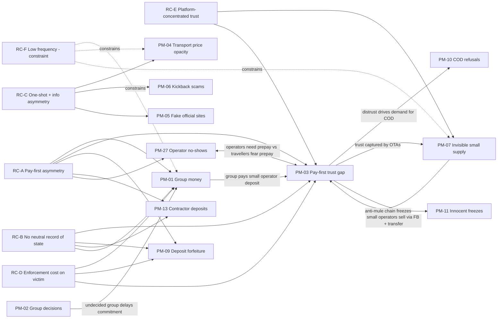

# Phase 4 — Problem Decomposition & Problem Graph

- **Phase:** 4 · **Compiled:** 2026-10-22 22:39 +07 (v1)
- **Input:** `03-problem-memory.md` (Tier 1 + Tier 2 + mechanism lessons from Tier 3)
- **Rule:** every connection carries a **causal rationale**; no keyword-only links. All structural claims below are **HYPOTHESIS** unless marked FACT (with the PM evidence they rest on).

---

## 1. Causal chains (Trigger → Behavior → Bottleneck → Consequence)

**PM-01 Group money**
Shared cost needed before full commitment / after trip (villa, van, fuel) → one person pays; rules improvised → **no agreed fairness rule + no commitment before spending + creditor must ask** → unpaid shares, dropouts (PT-07), friendship strain, organizer burnout (Skyscanner 82.5%, FACT).

**PM-03 Pay-first trust gap**
Cheap tour/stay/van/item on social media → buyer transfers deposit to personal account → **no cheap verification of a micro-seller; escrow only in commission platforms; blacklists lag** → loss for buyer; honest small operator discounted (lemons); buyers retreat to OTAs or demand COD (→ PM-10).

**PM-04 Transport price opacity**
Tourist needs a ride at hotspot → driver quotes flat price → **tourist lacks fair-price reference at the moment of decision; one-shot game; weak enforcement** → overpayment, complaints (10,687 in 5 months, FACT), brand damage; Grab premium paid by those who can.

**PM-09 Deposit forfeiture**
Tenant moves out → landlord holds and deducts deposit → **no jointly acknowledged move-in record; tenant must initiate; dorms outside 2025 rule** → money lost or costly dispute (สคบ. 1,655 complaints, FACT single source).

**PM-07 Invisible small supply**
Community certified → listed (or not) on OTAs → **no demand channel; OTA ranking favors volume/reviews; trust captured by OTA** → 45.3% of certified communities with zero tourists (FACT).

**PM-02 Group decisions**
Group must choose dates/budget/activities → unstructured chat; "anything is fine" → **one person absorbs coordination cost; no decision structure** → 10–40h planning (FACT vendor survey), burnout, trips delayed or abandoned.

---

## 2. Shared root causes (Root-Cause Families)

| RC | Root-cause family | Problems | Causal rationale |
|---|---|---|---|
| **RC-A** | **Pay-first asymmetry** — whoever moves money first bears all the risk, and the other party controls the outcome | PM-01, PM-03, PM-09, PM-10, PM-13, PM-14, PM-22 | In each case money moves before the counterpart's obligation is fulfilled (trip share, delivery, room return, job progress, service use, ferry connection). The holder has no incentive to perform/return unless the payer escalates. |
| **RC-B** | **Missing neutral, jointly acknowledged record of real-world state** (self-attestation) | PM-03 (operator legitimacy), PM-09 (room condition), PM-13 (work progress), PM-24 (stay happened — FACT case), PM-20 (accessibility), PM-01 (who agreed to what) | Disputes are resolved by whoever holds evidence; when the only evidence is self-reported by the interested party, collusion/forfeiture follows (เราเที่ยวด้วยกัน fraud FACT; deposit case FACT). |
| **RC-C** | **One-shot interaction + price/info asymmetry** (no repeat-game reputation) | PM-04, PM-05, PM-06, PM-21 | Tourists transact once; providers have no reputation to lose; fair-price or legitimacy information is not available at the moment of decision. |
| **RC-D** | **Enforcement cost falls on the wronged party** | PM-01 (asking friends), PM-03 (report after loss), PM-09 (tenant must complain), PM-11 (prove innocence), PM-15 (patient fetches slips) | Systems are complaint-driven; the victim pays time/social cost; many give up → stalling is rational for the other side. |
| **RC-E** | **Distribution & trust concentrated in large platforms**; zero-commission unsustainable | PM-07, PM-03, PM-17, PM-09 (indirect) | Trust is bundled with discovery + escrow inside OTAs/marketplaces; leaving them means losing trust; replacing them at 0% fails (Robinhood FACT). |
| **RC-F** | **Low frequency of use** (constraint, not a problem) | All travel PMs | Travel/planning used briefly → subscriptions fail (FACT Tripadvisor Plus, Flight Penguin), retention low (CleverTap FACT) → revenue must attach to a transaction or a frequent actor (operator/landlord), not the occasional traveller. (HYPOTHESIS) |

---

## 3. Problem Graph

### Edge rationale
| Edge | Rationale | Status |
|---|---|---|
| PM-02 → PM-01 | Until a group decides, no one can commit money; delayed decisions push one person to book & front cash | HYPOTHESIS (consistent with A-01/A-02 surveys) |
| PM-03 → PM-10 | COD is the buyer-side response to pay-first distrust; risk shifts to sellers | HYPOTHESIS (C) |
| PM-03 → PM-07 | Because small operators can't prove legitimacy, trust-seeking demand goes to OTAs, keeping small supply invisible/commission-bound | HYPOTHESIS (B, D) |
| PM-07 → PM-03 | Operators without OTA visibility sell via FB/LINE + transfer — the exact channel scammers imitate → honest and fake look identical | HYPOTHESIS (B) |
| PM-03 → PM-11 | The policy response to scam mule accounts (chain freezes) hits innocent holders | FACT (mechanism in BOT/Thai PBS sources) |
| PM-27 ↔ PM-03 | Two-sided trust deadlock: operators require deposits to deter no-shows (no written terms in chat bookings); travellers fear prepaying because of impersonation; official advice routes both to commission OTAs | HYPOTHESIS (raw I: FACT cases on both sides) |
| PM-01 → PM-03 | Thai group trips often pay deposits to vans/tours/villas via transfer (PT-08–10) → group-money problem feeds the trust problem | HYPOTHESIS (Pantip anecdotes) |

---

## 4. Stakeholder & Incentive Map (Tier 1)

| PM | Payer-first / wronged | Holder / counterpart | Benefits from status quo | Hidden stakeholder | Incentive misalignment |
|---|---|---|---|---|---|
| PM-01 | Organizer, creditor, car owner | Members who owe / may drop out | Stalling debtors; platforms with single payer | Driver/car owner (fuel norms); quiet members | Delay costs debtor nothing; asking costs creditor socially |
| PM-03 | Traveller/buyer | Micro-operator/seller (honest or fake) | Scammers, mule recruiters, OTAs | **Honest small operators** (lemons discount) | Fake sellers profit from looking identical to honest ones; OTAs profit from trust monopoly |
| PM-04 | Tourist | Driver/tout | Overcharging drivers, cartels, kickback shops | Metered honest drivers | One-shot: overcharging has no reputational cost |
| PM-09 | Tenant | Landlord/dorm | Forfeiting landlords | Honest landlords; next tenants | Keeping deposit costs nothing unless tenant escalates |

---

## 5. System Boundaries & Constraint Map

| Constraint | Applies to | Effect on solution space | Status |
|---|---|---|---|
| Cannot hold third-party money (escrow / collecting for sellers = licensed payment service; no small-volume exemption; only BOT sandbox) | PM-01, PM-03, PM-09, PM-13, PM-27 | Mechanisms must move money **peer-to-peer** (PromptPay QR, direct transfer) and only coordinate/record; no escrow | **FACT** (MoF 2018 regulated-services list, official PDF — raw G). Coordination-only QR needing no licence = HYPOTHESIS (not confirmed by BOT). Not legal advice |
| Zero budget; free tiers only | all | No paid data/APIs; LLM usage limited to free tiers | FACT (user) |
| ~1.5 build days, 1 dev | all | One core flow; must be demo-able with no existing users | FACT (timeline) / HYPOTHESIS (capacity) |
| Two-sided cold start | PM-03, PM-04, PM-07 | Value must exist for a **single user/party on day 1** (single-player mode) | HYPOTHESIS (D lesson 8, RF-04) |
| Thai behavior is LINE + PromptPay native | PM-01, PM-03 | A separate app adds friction; link-based web flows that work inside LINE likely preferred | HYPOTHESIS (D lesson 6) |
| Low travel frequency | travel PMs | Revenue tied to transaction or a frequent actor (operator, landlord, host) | HYPOTHESIS (FACT-backed cases) |
| PDPA / defamation risk of reputation data | PM-03, PM-10 | Avoid public named blacklists (criminal defamation up to 2 yrs / THB 200,000 + PDPA); opt-in self-verification and jointly taken room photos = low risk | FACT (law penalties) / HYPOTHESIS (risk grading), raw G |
| Unlicensed tour selling is illegal (up to 2 yrs and/or THB 500,000; FB seller arrested May 2026) | PM-03, PM-06 | Any tour-related mechanism must not facilitate unlicensed tour sales; homestays have **no public online register** | FACT/HYPOTHESIS per raw G |
| Incumbent: KhunThong (LINE treasurer bot) | PM-01 | Reminder/collection automation already exists in Thailand → differentiation must be elsewhere | FACT (exists) |

---

## 6. Failure-Point Analysis (where existing mechanisms break)

| PM | Failure point | Existing mechanism that breaks there |
|---|---|---|
| PM-01 | **Before booking** (commitment) and **at rule-setting** (fairness) | Ledgers act after spending; reminders act after debt exists |
| PM-03 | **At the moment of first transfer to an unknown seller** | Blacklists act after victims report; registries exclude homestays; escrow only inside OTAs |
| PM-04 | **At the curb, before getting in** | Grab only if tourist books via app; hotline after the ride |
| PM-09 | **At move-in** (no record) and **at move-out** (holder decides) | Law applies after dispute; excludes dorms |
| PM-07 | **At discovery + trust** | Certification without distribution; OTA ranking |

---

## 7. Cross-problem conflicts (a fix for one can hurt another)

| Fix | Helps | Hurts | Rationale / status |
|---|---|---|---|
| Public scammer blacklists | PM-03 buyers | Wrongly listed innocents; PDPA/defamation; mirrors PM-11 harm | HYPOTHESIS |
| COD | PM-03 buyers | PM-10 sellers | FACT-ish (C) |
| Anti-mule chain freezes | PM-03 victims | PM-11 innocent holders | FACT (BOT/Thai PBS) |
| Platform escrow | PM-03 | Requires licence; commission → PM-07 dependency | HYPOTHESIS |
| Zero-commission marketplace | PM-07 operators short-term | Platform dies (Robinhood) → operators stranded | FACT (Robinhood) |
| Subsidy paid on self-attested events | Demand stimulation | Collusion fraud (PM-24) | FACT (2021) |
| Gating core action of a free utility (paywall) | Revenue | Users defect (Splitwise, Couchsurfing) | FACT/HYPOTHESIS (D) |

---

## 8. Phase 4 conclusions (for the Generation session) — HYPOTHESIS
1. **RC-A (pay-first asymmetry) + RC-B (no neutral record)** form the densest region of the graph: they connect 3 of the 4 Tier-1 problems (PM-01, PM-03, PM-09) plus PM-10/PM-13. This is the most promising area for **Problem Fusion** — with the caveat that the fused mechanism must not hold money.
1b. **Two-sided trust deadlock (PM-03 ↔ PM-27)**: both traveller and honest operator want a trusted record of identity + terms + payment, and neither can supply it to the other; today OTAs resolve it for a commission. Supply-side cases are FACT (raw I).
2. **RC-C (one-shot info asymmetry)** is a separate family (PM-04/05/06) — travel-strong, evidence-strong, but revenue is the open question (who pays?). Driver-side: regulated fares below perceived cost (FACT, 2023) contribute to refusals → a pure tourist-side price checker ignores half the cause.
3. **RC-E (platform-concentrated trust)** links travel supply (PM-07) to PM-03: trust and discovery are bundled in OTAs; un-bundling *trust* from *discovery* may be cheaper than competing on discovery. (SPECULATION — direction only, not an idea.)
4. **RC-F** is a hard constraint: travel-only consumer subscriptions should be treated as a high-risk revenue assumption.
5. **Incumbents to beat or avoid:** KhunThong (PM-01 collection), Grab (PM-04 for cars), OTAs (PM-03/07 trust), Mindtrip/PolyTrip (PM-02 planning).
